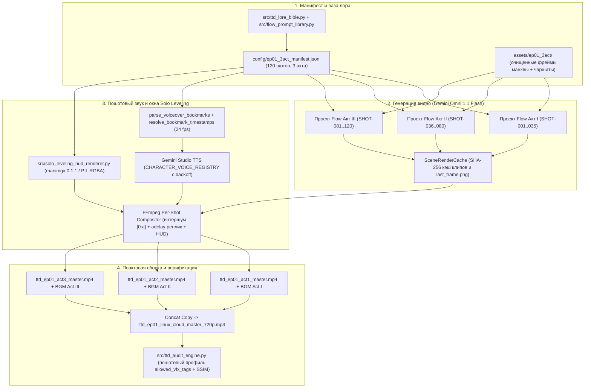

# Архитектура производства 1-й серии (Пролог / Этап 0, 15–20 минут) на базе Gemini Omni 1.1 Flash

*   **Автор:** orakulzero
*   **Статус:** Proposed
*   **Дата:** 2026-11-04

--------------------------------------------------------------------------------

## Обзор (Overview)

Данный проект задаёт архитектуру генерации, озвучивания, наложения голографических окон статуса и поактовой сборки 15–20-минутной первой серии экранизации *«Я стал графом-тираном в игре жанра Tower Defense»* (*디펜스 게임의 폭군이 되었다*). Первая серия целиком экранизирует сюжетную арку Пролога и Этапа 0 (главы `001화–010화` корейского ранобэ и главы 1–2 манхвы) в трёх актах по 5–7 минут (100–140 связанных шотов):

*   **Акт I (`001화 | Prologue. GAME CLEAR.` — Стрим финального 50-го этапа и перенос в игру):** Прохождение стримером (`Born Hater`) 50-го этапа тактической игры *«Защити Империю»* на режиме *Ironman Hell Mode* в разрушенном соборе, где среди гор погибших соратников (Евангелина, Джуниор и основной отряд) выживает только стартовый SSR-рыцарь Лукас Макгрегор; сообщение зрителя `Foxy` в чате о цене такой победы; системный опросник и перенос сознания игрока распорядителем игры Эйдером.
*   **Акт II (`002화–005화 | Stage 0. 튜토리얼이 시작합니다 ~ 솟아날 구멍은 있다` — Осада Передового Форта, дар Эша «Картография» и проверка отряда в каземате):** Пробуждение в теле 23-летнего 3-го имперского принца Эша Эверблэка (`EX-ранг`, `Начинающий командир`) на 3-й день осады Передового Форта (`전초기지`) армией из 1 109 монстров во главе с 6-м командиром Легиона Кошмара Чёрной Паучьей Королевой Орлоп (`Lv.??`), 196 осадными пауками (`Lv.60`) и 912 штурмовыми пауками (`Lv.55`). Накануне ночью оригинальный Эш предупредил своего телохранителя Лукаса (`SSR-ранг`, 22 года), что с завтрашнего дня изменится до неузнаваемости, но приказал не сомневаться и продолжать служить ему. В каземате Эш использует дар «Картография» (`지도 작성`) и «Дурной глаз командования» (`지휘의 마안`), а также проверяет на практике скрытые характеристики своих телохранителей при поддержке диэгетических голографических окон статуса в стиле *Solo Leveling*:
    *   Маг огня **Лили (`R-ранг`, `[릴리(R)]`)** — дар **«Огненная кожа» (`불꽃 피부`)**, рождённый из детского ужаса перед клинками и превращающий её тело в пламя для уклонения от физических атак за счёт расхода маны (`MP`); Эш доказывает это внезапным ударом кинжала в каземате.
    *   Целитель **Дэмиен (`N-ранг`, 18 лет, `[데미안(N)]`)** — дар **«Всевидящее Око» (`천리안`, Дальность обзора +50, Меткость +999)**; Эш снимает с него подавляющие зрение очки и ставит наводчиком за крепостной **`[Артефакт: Древняя Мана-Пушка (SR)]` (`고대 마나 대포`)**.
    *   Щитоносец **Кен (`N-ранг`, `[방패기사 켄(N)]`)** — бывший мелкий вор с семейным медальоном и близкий друг Дэмиена; дар **«Выживание мелкого вора» (`좀도둑의 생존법`)**, сбрасывающий агрессию врагов ценой расхода собственного здоровья (`HP`).
*   **Акт III (`006화–010화 | Stage 0. 결전 ~ 튜토리얼의 끝` — Решающий бой, жертва Кена и Лили, пробуждение «Несгибаемого командира», выстрел Дэмиена и отступление 9 выживших в «Перекрёсток»):** Лукас удерживает внешнюю стену; Кен выходит один за ворота для отвлечения роя пауков, теряет `HP` ниже порога активации скрытности и погибает в бою (`전사`); Лили перекрывает единственный узкий вход к центральной батарее пушки, пока её `MP` не падает до нуля, после чего «Огненная кожа» гаснет и удар паука парализует ей нижнюю часть тела (`하반신 마비`). Увидев гибель друга Кена после первого промаха, Дэмиен впадает в панику; Эш встряхивает его и пробуждает пассивный навык **`[Несгибаемый командир]` (`불굴의 지휘관` — иммунитет к панике и отчаянию в радиусе 10 м)**. Сбросив оцепенение, Дэмиен со второго выстрела Древней Мана-Пушки уничтожает Королеву Орлоп. Пауки разбегаются, оставляя россыпь мана-камней (`마석`) и Мана-Ядро Королевы, а 9 выживших из 200 бойцов гарнизона (Эш, Лукас, парализованная Лили, Дэмиен и 5 артиллеристов) собирают мана-камни и отступают в крепостной город «Перекрёсток» (`크로스로드`), где их встречает Эйдер (`011화`).

## Проблема (The Problem)

Существующий конвейер в репозитории [google-flow-video](file:///home/antigravity/orakulzero/google-flow-video) спроектирован под короткие 12-шотовые ролики (~48 секунд) и не позволяет собрать полноценную 15–20-минутную серию по канону ранобэ и манхвы по пяти причинам:

1.  **Фрагментарность и искажение первоисточника:** В текущих скриптах [scripts/generate_ep01_omni_flash_series.py](file:///home/antigravity/orakulzero/google-flow-video/scripts/generate_ep01_omni_flash_series.py) и [src/flow_prompt_library.py](file:///home/antigravity/orakulzero/google-flow-video/src/flow_prompt_library.py) первая глава сжата до 12 разрозненных сцен по 4 секунды, где пропущены предупреждение оригинального Эша Лукасу, проверка Лили кинжалом в каземате, отвлекающая вылазка и гибель Кена, истощение маны и паралич ног Лили у входа к батарее, паника Дэмиена от смерти друга, пробуждение навыка Эша «Несгибаемый командир» и сбор мана-камней 9 выжившими перед отступлением в «Перекрёсток». Кроме того, база лора ошибочно называет Эша «36-м принцем», а Лили — «слепым снайпером с арбалетом».
2.  **Смысловые провалы при отказе от закадрового диктора:** В серии запрещены голос диктора и внутренние монологи (в эстетике *Arcane* всё передаётся через эмоции, действие и диалоги). Однако без наглядной визуализации системных окон статуса зритель не поймёт точные игровые условия (почему «Огненная кожа» Лили отключается при `MP = 0`, почему Кен не может уйти в тень при низком `HP` и как аура Эша снимает панику с Дэмиена), а прямая генерация текста внутри видеомодели Omni 1.1 Flash приводит к нечитаемым символам.
3.  **Нарушение постоянства голосов и рассинхронизация речи:** Скрипт сборки [scripts/assemble_ep01_omni_flash_episode.py](file:///home/antigravity/orakulzero/google-flow-video/scripts/assemble_ep01_omni_flash_episode.py) допускает только один голос на весь шот (из-за чего реплики двух разных героев в одной сцене озвучиваются одним тембром), при ошибках сети молча сбрасывает голос на `edge_tts`, не вызывает парсер закладок [`parse_voiceover_bookmarks`](file:///home/antigravity/orakulzero/google-flow-video/src/flow_repo_adaptations.py#L136-L195) (рискуя озвучить XML-теги `<bookmark>` вслух) и замедляет видеопоток через `setpts`, когда реплика оказывается длиннее клипа.
4.  **Деградация изображения при длинной сцепке кадров и зависание браузера Flow:** Безостановочная передача последнего кадра в первый (`last_frame -> first_frame`) более 3 раз подряд размывает лица персонажей, а загрузка более 250 файлов в один проект Google Flow переполняет DOM-дерево браузера и приводит к падению Playwright по таймауту.
5.  **Ограничения сборщика и аудитора на дистанции 140 шотов:** Модуль [scripts/linux_cloud_video_assembler.py](file:///home/antigravity/orakulzero/google-flow-video/scripts/linux_cloud_video_assembler.py) сортирует шоты по двузначным индексам (`shot_01`..`shot_99`), затирает нативный звук клипов тишиной при отсутствии внешнего аудиофайла и падает по таймауту `240s` при сборке 20 минут видео, а [src/ttd_audit_engine.py](file:///home/antigravity/orakulzero/google-flow-video/src/ttd_audit_engine.py) отбраковывает кадры с кислотными снарядами пауков, пламенем Лили и свечением мана-камней.

Предлагаемое решение вводит единый декларативный манифест на 100–140 шотов (разбитый на 3 изолированных акта), генерацию видео исключительно через **Gemini Omni 1.1 Flash** с ограничением глубины сцепки до 3 шотов подряд и возвратом к очищенным кадрам манхвы в стиле *Arcane*, пост-композитное наложение голографических окон статуса в стиле *Solo Leveling* через `manimgx 0.1.1`, многоголосый синтез речи с неизменным реестром голосов по меткам `<bookmark>` и двухступенчатую поактовую сборку в FFmpeg.

## Цели (Goals)

*   **Полное покрытие глав `001화–010화` ранобэ и глав 1–2 манхвы (15–20 минут):** Сформировать декларативный манифест `ep01_3act_manifest.json` из 100–140 шотов (`SHOT-001`..`SHOT-140`), разделённый на Акт I (Стрим 50-го этапа и перенос), Акт II (Осада Передового Форта, предупреждение оригинального Эша Лукасу, «Картография» и проверка талантов отряда в каземате) и Акт III (Вылазка и гибель Кена, оборона входа в батарею и паралич ног Лили при `MP = 0`, паника Дэмиена и пробуждение «Несгибаемого командира» Эша, уничтожение Королевы Орлоп со второго залпа Древней Мана-Пушки, сбор мана-камней и отступление 9 выживших в «Перекрёсток»).
*   **Генерация видео на Gemini Omni 1.1 Flash без потери чёткости лиц:** Использовать модель `VideoModel.OMNI_FLASH` в стилистике *Arcane* (2.5D живописный рендер) с покадровой сцепкой `FRAME_CHAIN_LAST_TO_FIRST` длиной не более 3 шотов подряд внутри одного ракурса камеры и обязательным сбросом `HARD_ANCHOR_RESET` на эталонный фрейм манхвы + чаршит при каждой смене камеры или начале акта.
*   **Диэгетические голографические окна статуса в стиле *Solo Leveling*:** Реализовать детерминированный генератор полупрозрачных голографических панелей статуса на базе `manimgx 0.1.1` / PIL / FFmpeg alpha-overlay для 5 ключевых точек сюжета (тактическая сводка `STAGE 0`, «Огненная кожа» Лили `R-ранга`, «Всевидящее Око» Дэмиена `N-ранга` + `SR`-пушка, расход `HP` Кена `N-ранга`, падение `MP` Лили до `0%` и пробуждение `[Несгибаемого командира]` Эша) с чёткой кириллической типографикой без генерации текста внутри видеомодели.
*   **Инвариантность голосов и синхронизация реплик без диктора:** Закрепить за каждым персонажем постоянный голосовой идентификатор (`CHARACTER_VOICE_REGISTRY`: `ASH -> Alnilam`, `LUCAS -> Orus`, `LILY -> Aoede`, `DAMIEN -> Fenrir`, плюс отдельные профили для `KEN` и `EIDER`) без переключения на резервные движки с другим тембром, с поддержкой нескольких реплик разных героев внутри одного шота и синхронизацией по `<bookmark mark="..."/>` при `24 fps` без изменения скорости видеопотока (`1.0x`).
*   **Иерархическая поактовая сборка и аудит:** Собирать и верифицировать каждый из трёх актов независимо (`ttd_ep01_act1_master.mp4`, `act2`, `act3`) с сохранением нативного интершума Omni 1.1 Flash, непрерывной музыкальной дорожкой на акт и поактовыми контакт-листами превью, после чего склеивать три акта без перекодирования (`-f concat -c copy`) в финальный мастер `1280x720 @ 24 fps CFR, AAC 48 kHz` и выгружать в Google Drive `03_master_renders_outbox`.

## Не-цели (Non-Goals)

*   Использование старых моделей семейства `veo_3_1_t2v_*`, закадрового голоса рассказчика или внутренних монологов.
*   Рендеринг кириллического или корейского текста системных окон непосредственно внутри нейросети Gemini Omni 1.1 Flash (все окна статуса накладываются отдельным векторным слоем при постобработке).
*   Создание графического веб-интерфейса нелинейного монтажа (NLE) вместо декларативного JSON-манифеста и пакетной сборки через FFmpeg.
*   Экранизация событий глав `011화+` (прибытие в сам город «Перекрёсток», знакомство с Эйдером в городе и подготовка к 1-й волне обороны), которые относятся ко 2-й серии.

## Открытые вопросы (Open Questions)

*   На текущий момент открытых архитектурных вопросов нет: канонический состав сцен Пролога / Этапа 0 (`001화–010화`), использование голографических окон статуса в стиле *Solo Leveling*, закрепление голосов и разбивка на 3 акта согласованы на этапе `/egm-brainstorm`.

## Ключевые пользовательские сценарии (Critical User Journeys — CUJs)

### CUJ 1: Генерация видеоклипов одного акта в Google Flow через Gemini Omni 1.1 Flash с кэшированием и контролем цепочек

*   **Дано (Given):** В репозитории сформирован манифест `ep01_3act_manifest.json`, в папке `assets/ep01_3act/` подготовлены очищенные референсные фреймы манхвы и эталонные чаршиты персонажей (`Ash`, `Lucas`, `Lily`, `Damien`, `Ken`, `Eider`, `Orlop`), а в Google Flow открыт выделенный проект соответствующего акта (например, Акт II — 45 шотов).
*   **Когда (When):** Оператор запускает скрипт генерации для выбранного акта (`--act 2`).
*   **Тогда (Then):**
    1. Скрипт проверяет локальный кэш [SceneRenderCache](file:///home/antigravity/orakulzero/google-flow-video/src/flow_repo_adaptations.py#L778-L931) и пропускает уже сгенерированные и прошедшие аудит шоты.
    2. Для шотов с режимом `HARD_ANCHOR_RESET` (первый шот акта, смена ракурса камеры или каждый 4-й шот после цепочки из 3 сцеплений) в слоты ингредиентов Google Flow передаются эталонный фрейм сцены и чаршит персонажа.
    3. Для шотов с режимом `FRAME_CHAIN_LAST_TO_FIRST` (глубина цепочки `1..3` внутри одного ракурса) скрипт извлекает последний кадр предыдущего клипа (`last_frame.png`) и передаёт его как начальный кадр следующего шота в модели `VideoModel.OMNI_FLASH`.
    4. Все отрендеренные клипы сохраняются с трёхзначными именами (`SHOT-036.mp4`..`SHOT-080.mp4`), содержащими нативную звуковую дорожку интершума Omni 1.1 Flash.

### CUJ 2: Пошотовый синтез многоголосой озвучки по закладкам `<bookmark>` и наложение голографических окон *Solo Leveling*

*   **Дано (Given):** Получены сырые видеоклипы акта (`SHOT-001.mp4`..`SHOT-140.mp4`), в манифесте для каждого шота заданы массив реплик `dialogue_turns` с тегами `<bookmark mark="..."/>` и (для ключевых сцен) описание голографического окна `status_window_overlay`.
*   **Когда (When):** Запускается конвейер озвучивания и пошотового композитинга.
*   **Тогда (Then):**
    1. Для каждой реплики в `dialogue_turns` вызывается [`parse_voiceover_bookmarks`](file:///home/antigravity/orakulzero/google-flow-video/src/flow_repo_adaptations.py#L136-L195), отделяющий чистый русский текст от позиций закладок, и синтезируется аудиодорожка строго закреплённым голосом персонажа из `CHARACTER_VOICE_REGISTRY` (с повторными попытками при HTTP 429 без сброса на `edge_tts`).
    2. Через [`resolve_bookmark_timestamps`](file:///home/antigravity/orakulzero/google-flow-video/src/flow_repo_adaptations.py#L305-L384) (`fps=24`) вычисляются точные миллисекундные смещения `adelay` для каждой реплики внутри окна шота; при необходимости длительность аудио поджимается через `atempo` (`0.92x..1.08x`), а скорость видео остаётся неизменной (`1.0x`).
    3. Если для шота задан `status_window_overlay` (например, удар кинжалом по Лили в каземате с окном `[Лили (R) — Огненная кожа]` или пробуждение `[Несгибаемого командира]` Эша), модуль `manimgx 0.1.1` / PIL генерирует полупрозрачный голографический оверлей в стиле *Solo Leveling* с альфа-каналом и звуковым импульсом системы, который накладывается поверх видеопотока, а реплики сводятся поверх приглушённого (ducked) нативного интершума `[0:a]`.

### CUJ 3: Поактовая сборка, верификация через `ttd_audit_engine` и выпуск финального 20-минутного мастера

*   **Дано (Given):** Все шоты Акта I, Акта II и Акта III прошли пошотовый композитинг и сведение диалогов.
*   **Когда (When):** Запускается сборщик серии `scripts/linux_cloud_video_assembler.py`.
*   **Тогда (Then):**
    1. Сборщик формирует три независимых мастер-файла актов (`ttd_ep01_act1_master.mp4`, `ttd_ep01_act2_master.mp4`, `ttd_ep01_act3_master.mp4`), накладывая непрерывную дорожку фоновой музыки на каждый акт целиком и генерируя для каждого акта контакт-лист превью.
    2. Три готовых акта склеиваются без повторного перекодирования видео (`ffmpeg -f concat -c copy -movflags +faststart`) в единый файл `ttd_ep01_linux_cloud_master_720p.mp4` (`1280x720`, `24 fps` CFR, `48000 Hz` stereo AAC) вместе с полными субтитрами `.srt`/`.vtt` без XML-тегов.
    3. Модуль [src/ttd_audit_engine.py](file:///home/antigravity/orakulzero/google-flow-video/src/ttd_audit_engine.py) проверяет каждый шот по его профилю `allowed_vfx_tags`, удостоверяется в отсутствии пропусков звука и целостности стыков (`SSIM >= 0.92` на сцепленных парах), после чего готовый мастер выгружается в Google Drive `03_master_renders_outbox`.

--------------------------------------------------------------------------------

## Технический план (Technical Plan — Architecture)

### 1. Общая схема конвейера производства

Производственный конвейер разделён на четыре последовательных контура: (1) декларативный манифест и подготовка эталонных фреймов, (2) поактовая генерация видеоклипов в Google Flow через `VideoModel.OMNI_FLASH`, (3) пошотовый синтез многоголосой речи по закладкам `<bookmark>` и наложение голографических окон статуса в стиле *Solo Leveling*, (4) двухступенчатая поактовая сборка и автоматический аудит.



### 2. Схемы данных и структура манифеста `config/ep01_3act_manifest.json`

Вместо разрозненных списков в Python-скриптах вводится единый типизированный манифест серии. Каждый шот описывается структурой `ShotManifestEntry` с трёхзначным идентификатором `SHOT-001`..`SHOT-120`:

```text
EpisodeManifest
 ├── episode_id: "ttd_ep01_prologue_stage0"
 ├── target_resolution: "1280x720"
 ├── target_fps: 24
 ├── audio_sample_rate: 48000
 ├── character_voice_registry: dict[SpeakerId, VoiceProfile]
 │    ├── "ASH"     -> { voice_id: "Alnilam", gender: "M", pitch_semitones: 0.0 }
 │    ├── "LUCAS"   -> { voice_id: "Orus",    gender: "M", pitch_semitones: -1.0 }
 │    ├── "LILY"    -> { voice_id: "Aoede",   gender: "F", pitch_semitones: 0.0 }
 │    ├── "DAMIEN"  -> { voice_id: "Fenrir",  gender: "M", pitch_semitones: +1.5 }
 │    ├── "KEN"     -> { voice_id: "Charon",  gender: "M", pitch_semitones: -2.0 }
 │    ├── "EIDER"   -> { voice_id: "Puck",    gender: "M", pitch_semitones: +0.5 }
 │    └── "FOXY"    -> { voice_id: "Kore",    gender: "F", pitch_semitones: +1.0 }
 └── acts: list[ActSpec] (Act 1, Act 2, Act 3)
      ├── act_id: 1 | 2 | 3
      ├── flow_project_name: str
      ├── bgm_track_path: str
      └── shots: list[ShotManifestEntry]
           ├── shot_id: "SHOT-001" .. "SHOT-120"
           ├── chapter_ref: "001화" .. "010화"
           ├── duration_sec: int (4..10)
           ├── chain_mode: "HARD_ANCHOR_RESET" | "FRAME_CHAIN_LAST_TO_FIRST"
           ├── chain_depth: int (0..3)
           ├── start_frame_anchor: str (путь к очищенному фрейму манхвы для HARD_ANCHOR_RESET)
           ├── end_frame_anchor: Optional[str]
           ├── character_sheet_refs: list[str]
           ├── omni_visual_prompt: str (строго на английском для модели Omni 1.1 Flash)
           ├── allowed_vfx_tags: list[str] (например: ["GREEN_ACID", "FLAME_SKIN", "SOLO_HUD", "MANA_CANNON_BEAM", "GOLD_AURA"])
           ├── status_window_overlay: Optional[StatusWindowSpec]
           └── dialogue_turns: list[DialogueTurn]
```

#### Спецификация реплики (`DialogueTurn`) и голографического окна (`StatusWindowSpec`)

*   **`DialogueTurn`**:
    *   `turn_index: int` — порядковый номер реплики внутри шота (`0..N`).
    *   `speaker_id: str` — ключ из `character_voice_registry`.
    *   `raw_bookmarked_text: str` — текст реплики на русском языке с встроенными тегами `<bookmark mark="..."/>` (например: `"<bookmark mark='slash'/>Лили, не смей закрывать глаза! <bookmark mark='flame'/>Смотри на клинок!"`).
    *   `window_start_sec: float` и `window_end_sec: float` — допустимый интервал звучания реплики внутри шота. Обязательное инвариантное правило: `window_end_sec <= duration_sec - 0.5`, чтобы последние `0.5 с` каждого шота губы персонажа были сомкнуты перед извлечением `last_frame.png`.
*   **`StatusWindowSpec` (голографическое окно в стиле *Solo Leveling*)**:
    *   `window_type: "STAGE_ALERT" | "TRAIT_INSPECT" | "ARTIFACT_INSPECT" | "RESOURCE_DEPLETED" | "SKILL_AWAKENING"`
    *   `theme_color: "BLUE_CYAN" | "CRIMSON_WARNING" | "GOLD_AWAKENING"`
    *   `rank_badge: Optional["EX" | "SSR" | "SR" | "R" | "N"]`
    *   `header_title: str` — заголовок окна на русском языке (с дублированием корейского термина в скобках).
    *   `body_lines: list[str]` — строки параметров и описания механики.
    *   `resource_bar: Optional[dict]` — визуальная полоса `HP` или `MP` (например, `{"label": "MP", "from_pct": 35, "to_pct": 0, "status": "ДЕАКТИВИРОВАНО"}`).
    *   `appear_sec: float`, `disappear_sec: float`, `screen_anchor: "TOP_RIGHT" | "CENTER_LEFT" | "BOTTOM_RIGHT"`.

### 3. Поактовая структура серии (120 шотов по главам `001화–010화`)

Серия разбита на 3 независимых акта (по 35–45 шотов в каждом, длительность каждого шота 6–8 секунд, суммарный хронометраж 15–18 минут):

| Акт и главы ранобэ | Диапазон шотов | Сюжетные блоки и ключевые действия в кадре | Окна статуса в стиле *Solo Leveling* (`manimgx` overlay) | Режим сцепки кадров |
| :--- | :--- | :--- | :--- | :--- |
| **Акт I: Пролог (`001화 GAME CLEAR`)** | `SHOT-001` – `SHOT-035` (~5 мин) | 1. Комната стримера `Born Hater`: последние секунды штурма 50-го этапа *«Защити Империю»* на *Ironman Hell Mode*.<br>2. Экран монитора и переход в разрушенный собор: горы тел павших героев (Евангелина, Джуниор и др.), выживший SSR-рыцарь Лукас стоит спиной.<br>3. Донат зрителя `Foxy` в чате (*«Ты правда доволен концовкой, где погибли все, кроме одного?»*), спор стримера вслух.<br>4. Появление системного опросника распорядителя Эйдера, искажение пространства и перенос сознания в экран `STAGE 0 — ПЕРЕДОВОЙ ФОРТ`. | Системное окно завершения игры `[GAME CLEAR — STAGE 50 (IRONMAN HELL MODE) | Выживших: 1 (Лукас Макгрегор)]` и окно переноса `[Запуск STAGE 0: Передовой Форт]`. | Сброс `HARD_ANCHOR_RESET` на смене комнаты и собора; внутри каждой мизансцены — цепочки по 2–3 шота `FRAME_CHAIN_LAST_TO_FIRST`. |
| **Акт II: Этап 0 — Осада и каземат (`002화–005화`)** | `SHOT-036` – `SHOT-080` (~6.5 мин) | 1. Match-cut руки стримера в руку 23-летнего 3-го принца Эша (`EX-ранг`) на горящей стене Передового Форта.<br>2. Залп зелёной кислоты 196 осадных пауков; Лукас (`SSR-ранг`) спасает Эша и напоминает его вчерашние ночные слова: *«Вы сами велели мне вчера ночью не сомневаться в вас, каким бы другим человеком вы ни стали с утра»*.<br>3. В каземате Эш применяет «Картографию» (`지도 작성`) и «Дурной глаз командования» (`지휘의 마안`), определяя позицию Королевы Орлоп.<br>4. Проверка отряда: **Эш внезапно бьёт Лили кинжалом** — от ужаса перед клинком её тело обращается в пламя («Огненная кожа»); Эш снимает очки с 18-летнего Дэмиена («Всевидящее Око») и ставит его за `SR`-пушку; Кен показывает семейный медальон и свой навык скрытности за счёт `HP`. | 1. **Окно угрозы `STAGE 0`:** `[Врагов: 1 109 | Чёрная Паучья Королева Орлоп (Lv.??), Осадные пауки (Lv.60) ×196, Штурмовые (Lv.55) ×912]`.<br>2. **Окно Лили (`R-ранг`):** `[Дар: Огненная кожа (불꽃 피부) — Рождена из ужаса перед клинками. Превращает тело в пламя для уклонения от физ. атак. Расходует MP]`.<br>3. **Окно Дэмиена (`N-ранг`) + Пушки (`SR`):** `[Дар: Всевидящее Око (천리안) — Обзор +50, Меткость +999]` + `[Артефакт: Древняя Мана-Пушка (SR)]`.<br>4. **Окно Кена (`N-ранг`):** `[Дар: Выживание мелкого вора (좀도둑의 생존법) — Сброс агрессии ценой расхода HP]`. | `SHOT-036` начинается с `HARD_ANCHOR_RESET`. Сцены на стене и в каземате идут блоками по 3 шота с возвратом к эталонным фреймам и чаршитам при смене говорящего. |
| **Акт III: Решающий бой и отступление (`006화–010화`)** | `SHOT-081` – `SHOT-120` (~6.5 мин) | 1. Лукас держит внешнюю стену; Кен выходит один за ворота, уводя рой пауков от башни с пушкой, теряет `HP` ниже порога скрытности и погибает (`전사`), роняя окровавленный медальон.<br>2. Первый залп пушки проходит мимо; Дэмиен видит смерть друга Кена и впадает в панику и ступор.<br>3. Лили в одиночку перекрывает узкий вход к центральной батарее; когда её `MP` падает до `0%`, «Огненная кожа» гаснет, и удар паука вызывает у неё **паралич нижней части тела (`하반신 마비`)**.<br>4. Эш встряхивает Дэмиена и пробуждает пассивный навык **«Несгибаемый командир» (`불굴의 지휘관`)**; очищенный от паники Дэмиен до кровавых слёз фокусирует «Всевидящее Око» и **со второго выстрела** испепеляет Королеву Орлоп.<br>5. Сбор всех мана-камней (`마석`) и ядра Орлоп; **9 выживших** (Эш, Лукас, парализованная Лили на руках Лукаса, Дэмиен и 5 канониров) отступают в «Перекрёсток», где их встречает Эйдер. | 1. **Окно Кена (красное):** `[HP: 8% — Недостаточно HP для активации «Выживания мелкого вора»!]`.<br>2. **Окно Лили (красное):** `[MP: 0/100 — Навык «Огненная кожа» деактивирован! Получено увечье: Паралич нижней части тела]`.<br>3. **Золотое окно пробуждения Эша:** `[Пробуждён пассивный навык: Несгибаемый командир (불굴의 지휘관) — Иммунитет к панике и отчаянию для всех союзников в радиусе 10 м]`.<br>4. **Итоговое окно этапа:** `[STAGE 0 CLEAR | Выживших: 9 | Получено: Мана-ядро Чёрной Королевы Орлоп и мана-камни]`. | `SHOT-081` начинается с `HARD_ANCHOR_RESET`. Чередование параллельного монтажа (ворота Кена / проход Лили / башня пушки Дэмиена и Эша), где каждый переход между локациями автоматически служит точкой `HARD_ANCHOR_RESET`. |

### 4. Механизм покадровой сцепки и предотвращения деградации в Google Flow

Чтобы избежать накопления артефактов сжатия и переполнения памяти вкладки Google Flow:

1.  **Изоляция по актам:** Каждый из трёх актов рендерится в отдельном проекте Google Flow (`TTD_EP01_ACT1`, `TTD_EP01_ACT2`, `TTD_EP01_ACT3`). В начале работы с актом скрипт [scripts/generate_ep01_omni_flash_series.py](file:///home/antigravity/orakulzero/google-flow-video/scripts/generate_ep01_omni_flash_series.py) один раз загружает чаршиты задействованных в акте героев в библиотеку проекта и переиспользует их без повторной загрузки на каждом шоте.
2.  **Лимит глубины цепочки (`MAX_CHAIN_DEPTH = 3`):**
    *   При `chain_mode == "HARD_ANCHOR_RESET"` (`chain_depth == 0`) в первый слот ингредиента загружается очищенный и стилизованный под *Arcane* фрейм манхвы (`start_frame_anchor`), а во второй слот — эталонный чаршит основного персонажа в кадре.
    *   При `chain_mode == "FRAME_CHAIN_LAST_TO_FIRST"` (`chain_depth in {1, 2, 3}`) из предыдущего видеоклипа `SHOT-(N-1).mp4` через `ffmpeg -sseof -0.04 -i prev.mp4 -frames:v 1` извлекается последний кадр без потерь (`PNG`), проходит лёгкую коррекцию контраста/резкости (`unsharp=3:3:0.3`) для компенсации сглаживания Omni 1.1 Flash и подаётся как стартовый кадр шота `N`.
    *   После 3 сцепленных шотов подряд или при любой смене ракурса камеры следующий шот принудительно переводится в `HARD_ANCHOR_RESET`.

### 5. Генератор голографических окон статуса *Solo Leveling* (`src/solo_leveling_hud_renderer.py`)

Для 100%-ной читаемости кириллического текста системных окон без участия видеомодели создаётся модуль `src/solo_leveling_hud_renderer.py`:

1.  По спецификации `StatusWindowSpec` из манифеста модуль строит полупрозрачную векторную панель (тёмно-сапфировый градиент `#071324CC`, неоновая голубая/золотая/алая рамка с угловыми засечками в эстетике *Solo Leveling*, бейдж ранга `EX / SSR / SR / R / N`, чёткая кириллическая гарнитура без засечек и анимированная полоска `HP`/`MP`).
2.  Через установленный в окружении `manimgx 0.1.1` / PIL рендерится последовательность кадров с альфа-каналом (`RGBA MOV/PNG-sequence`, `24 fps`) с эффектом вертикального раскрытия окна (`0.25 с`), лёгким параллаксом и свечением краёв.
3.  При пошотовой сборке оверлей накладывается поверх сырого клипа Omni 1.1 Flash фильтром FFmpeg `overlay=x:y:format=auto` синхронно со звуковым кристаллом открытия системного окна (`system_hud_chime.wav`).

### 6. Контур многоголосой озвучки и пошотового сведения звука

Для каждого шота `SHOT-NNN` сборщик выполняет детерминированное сведение аудио:

1.  **Разбор закладок и синтез речи:** Для каждого элемента `turn` в `dialogue_turns` вызывается [`parse_voiceover_bookmarks(turn.raw_bookmarked_text)`](file:///home/antigravity/orakulzero/google-flow-video/src/flow_repo_adaptations.py#L136-L195). Очищенный от XML-тегов текст отправляется в Gemini Studio TTS с голосом `character_voice_registry[turn.speaker_id]`. При ответе `HTTP 429` или сетевом сбое применяется экспоненциальная задержка (`2s -> 4s -> 8s -> 16s`, до 5 попыток); автоматический откат на `edge_tts` полностью отключён, чтобы тембр персонажа никогда не менялся.
2.  **Привязка по таймкодам закладок:** Функция [`resolve_bookmark_timestamps(bookmarks, voice_dur, fps=24)`](file:///home/antigravity/orakulzero/google-flow-video/src/flow_repo_adaptations.py#L305-L384) вычисляет точное смещение старта реплики `delay_ms = int(turn.window_start_sec * 1000)`. Если синтезированная фраза превышает длину окна `window_end_sec - window_start_sec`, к аудиодорожке реплики применяется мягкое сжатие темпа `atempo` в диапазоне `0.92..1.08` (скорость видеопотока `setpts` никогда не изменяется и всегда равна `1.0x`).
3.  **Граф микширования FFmpeg на уровне шота:**
    *   Вход `[0:a]` — нативная звуковая дорожка клипа Omni 1.1 Flash (шум дождя, взрывы кислоты, лязг мечей), приглушаемая (`volume=0.35`) в интервалах, где звучат реплики.
    *   Входы `[1:a]..[K:a]` — реплики персонажей со смещениями `adelay={delay_ms}|{delay_ms}` и нормализацией громкости.
    *   Вход `[H:a]` (опционально) — звуковой импульс появления голографического окна *Solo Leveling*.
    *   Все дорожки сводятся через `amix=inputs=...:normalize=0` в `48000 Hz, stereo`.
4.  **Наложение музыки на уровне Акта и финальная склейка:** Непрерывная дорожка фоновой музыки акта (`bgm_track_path` с плавным вступлением `afade=t=in` и затуханием `afade=t=out`) микшируется поверх сшитых шотов акта при сборке `ttd_ep01_act{1,2,3}_master.mp4`. Затем три готовых мастер-файла актов объединяются в итоговый 20-минутный фильм `ttd_ep01_linux_cloud_master_720p.mp4` через `ffmpeg -f concat -safe 0 -i acts_list.txt -c copy -movflags +faststart`.

--------------------------------------------------------------------------------

## Рассмотренные альтернативы (Alternatives Considered)

### Альтернатива A: Сжатие Пролога в 12 шотов (~48 секунд) или сокращение Этапа 0 без вылазки Кена, паралича Лили и пробуждения «Несгибаемого командира»

*   **Плюсы (Pros):** Минимальное время генерации в Google Flow (менее 30 минут) и простота сборки одним вызовом FFmpeg.
*   **Минусы (Cons):** Полный распад причинно-следственных связей первоисточника (`001화–010화`). Без вылазки и гибели Кена зритель не поймёт, почему Дэмиен впадает в отчаяние у орудия и как Эш пробуждает пассивный навык «Несгибаемый командир» (`불굴의 지휘관`). Без истощения маны Лили (`MP = 0`) у входа в батарею непонятно, почему в «Перекрёсток» она прибывает с парализованными ногами, а без сбора мана-камней и ядра Королевы Орлоп теряется происхождение будущего оружия отряда и причина отступления ровно 9 выживших.
*   **Причина отказа (Reason for Rejection):** Противоречит целевому хронометражу 15–20 минут и требованию полного соответствия канону ранобэ и манхвы.

### Альтернатива B: Объяснение игровых механик через голос диктора / внутренний монолог или полный отказ от окон статуса

*   **Плюсы (Pros):** Голос за кадром позволяет зачитать текст ранобэ напрямую без проработки визуальных триггеров; полный отказ от окон статуса избавляет от пост-композитинга.
*   **Минусы (Cons):** Закадровый диктор и внутренние монологи разрушают драматическое погружение в эстетике *Arcane* (где всё передаётся через эмоции и диалог). В свою очередь, при полном отказе от системных окон зритель не может считать точные численные условия мира игры (`R/N-ранг`, расход `MP` при каждом уклонении «Огненной кожи» Лили, порог `HP` для скрытности Кена, радиус `10 м` у «Несгибаемого командира»).
*   **Причина отказа (Reason for Rejection):** Выбрана гибридная схема без диктора: живые диалоги + диэгетические голографические окна статуса в стиле *Solo Leveling*, появляющиеся перед глазами Эша только в 5 ключевых точках проверки и боя.

### Альтернатива C: Генерация текста системных окон напрямую внутри видеомодели Gemini Omni 1.1 Flash

*   **Плюсы (Pros):** Не требует отдельного рендера векторных оверлеев через `manimgx 0.1.1` / PIL.
*   **Минусы (Cons):** Диффузионные видеомодели искажают кириллические и корейские глифы, путают цифры (`+999`, `MP 0/100`) и меняют начертание букв от кадра к кадру. Кроме того, наличие мелкого текста в кадре мешает работе детектора артефактов [src/ttd_audit_engine.py](file:///home/antigravity/orakulzero/google-flow-video/src/ttd_audit_engine.py).
*   **Причина отказа (Reason for Rejection):** Наложение голографических окон статуса отдельным векторным RGBA-слоем поверх чистого видеоклипа гарантирует 100%-ную читаемость текста на русском языке и единый визуальный стиль *Solo Leveling*.

### Альтернатива D: Непрерывная сцепка `last_frame -> first_frame` через все 120 шотов подряд в одном проекте Google Flow

*   **Плюсы (Pros):** Отсутствие необходимости готовить промежуточные эталонные кадры (`start_frame_anchor`) после первого шота.
*   **Минусы (Cons):** Уже после 3–4 последовательных перезапусков `last_frame -> first_frame` накапливаются артефакты квантования H.264, падает микроконтраст, размываются черты лиц, а при смене локации (например, переход от ворот Кена к батарее Дэмиена) модель создаёт неестественный морфинг пространства. Загрузка 120+ шотов и 250+ ассетов в один проект переполняет память браузера и обрушивает Playwright.
*   **Причина отказа (Reason for Rejection):** Ограничение глубины цепочки `FRAME_CHAIN_LAST_TO_FIRST` максимум 3 шотами подряд внутри одного ракурса с жёстким сбросом `HARD_ANCHOR_RESET` на сменах камеры и разделением на 3 проекта по актам сохраняет чёткость лиц и стабильность браузера.

### Альтернатива E: Генерация речи внутри промпта видеомодели или резервный откат на `edge_tts`

*   **Плюсы (Pros):** Не нужно управлять квотами и повторными попытками к Gemini Studio TTS.
*   **Минусы (Cons):** Генерация голоса внутри видеомодели даёт случайный тембр в каждом новом клипе, а тихий откат на `edge_tts` (зашитый сейчас в [scripts/assemble_ep01_omni_flash_episode.py](file:///home/antigravity/orakulzero/google-flow-video/scripts/assemble_ep01_omni_flash_episode.py#L157-L189)) подменяет голоса `Alnilam`, `Orus` и `Fenrir` на один стандартный голос посреди сцены.
*   **Причина отказа (Reason for Rejection):** Строгая фиксация голосов в `character_voice_registry` с экспоненциальными повторными попытками и синхронизацией по `<bookmark>` обеспечивает неизменность голоса каждого героя на протяжении всех 20 минут.

### Альтернатива F: Монолитная сборка всех 120 шотов одним графом `filter_complex` с растягиванием видео `setpts`

*   **Плюсы (Pros):** Один скрипт вызова FFmpeg без промежуточных мастер-файлов актов.
*   **Минусы (Cons):** Граф из 120 видеовходов и 250+ аудиодорожек превышает лимит открытых дескрипторов и падает по таймауту `240s`, замедление видео через `setpts` при длинной реплике дёргает картинку и рассинхронизирует взрывы, а правка одного шота требует полного перекодирования 20-минутного фильма.
*   **Причина отказа (Reason for Rejection):** Пошотовое сведение диалогов с фиксированной скоростью видео `1.0x` и двухступенчатая поактовая сборка (`act1`, `act2`, `act3` -> `concat -c copy`) позволяют пересобирать любой шот за секунды.

--------------------------------------------------------------------------------

## Нефункциональные требования (Non-Functional Requirements)

*   **Производительность и отказоустойчивость генерации:**
    *   Каждый отрендеренный клип и синтезированная реплика кэшируются по SHA-256 хешу входа в [SceneRenderCache](file:///home/antigravity/orakulzero/google-flow-video/src/flow_repo_adaptations.py#L778-L931). Повторный запуск после сбоя сети продолжает работу с первого незавершённого шота без повторной генерации готовых сцен.
    *   Время полной пересборки одного акта (40 шотов) из кэшированных клипов и аудиодорожек на облачной Linux-машине не должно превышать 180 секунд, а финальная склейка трёх актов через `-c copy` — не более 10 секунд.
*   **Инварианты качества аудио и видео:**
    *   Строгая кадровая частота `24.00 fps` CFR (`vsync cfr`), разрешение `1280x720`, профиль `H.264 High@L4.0`, пиксельный формат `yuv420p`, аудио `AAC LC 48000 Hz stereo 192 kbps`.
    *   Структурное сходство (`SSIM`) между последним кадром шота `N` и первым кадром шота `N+1` внутри цепочки `FRAME_CHAIN_LAST_TO_FIRST` — не ниже `0.92`.
    *   Полное отсутствие необработанных XML-тегов `<bookmark>` в аудиодорожках и субтитрах `.srt`/`.vtt`.

--------------------------------------------------------------------------------

## Детальный план реализации (Detailed Implementation Plan)

### Целевые файлы для создания и модификации (Target Files to Create/Modify)

#### 1. [config/ep01_3act_manifest.json](file:///home/antigravity/orakulzero/google-flow-video/config/ep01_3act_manifest.json) (Create)

*   **Тип / Область (Type / Scope):** Декларативный JSON-манифест 1-й серии (120 шотов, 3 акта).
*   **Обоснование и изменения (Proposed Changes & Rationale):** Создаёт единый источник истины для генерации видео, озвучки, наложения окон статуса и сборки вместо разрозненных списков в Python-скриптах. Содержит:
    *   Реестр голосов `character_voice_registry` (`ASH -> Alnilam`, `LUCAS -> Orus`, `LILY -> Aoede`, `DAMIEN -> Fenrir`, `KEN -> Charon`, `EIDER -> Puck`, `FOXY -> Kore`).
    *   Три блока актов (`act_id: 1, 2, 3`), охватывающих главы `001화–010화` корейского ранобэ и главы 1–2 манхвы (`SHOT-001`..`SHOT-120`).
    *   Для каждого шота: `duration_sec`, `chain_mode` (`HARD_ANCHOR_RESET` или `FRAME_CHAIN_LAST_TO_FIRST` с `chain_depth <= 3`), пути к очищенным фреймам манхвы и чаршитам, английский визуальный промпт для `VideoModel.OMNI_FLASH`, массив `allowed_vfx_tags`, опциональную спецификацию окна статуса `status_window_overlay` (в стиле *Solo Leveling*) и массив реплик `dialogue_turns` с тегами `<bookmark mark="..."/>` и отступом `0.5 с` до конца шота.

#### 2. [src/ttd_lore_bible.py](file:///home/antigravity/orakulzero/google-flow-video/src/ttd_lore_bible.py) (Modify)

*   **Тип / Область (Type / Scope):** Модуль канонических карточек персонажей, монстров, локаций и правил визуального стиля.
*   **Обоснование и изменения (Proposed Changes & Rationale):** Устраняет расхождения с первоисточником (`001화–010화`):
    *   Исправляет карточку **Эша Эверблэка** (`3-й имперский принц`, 23 года, `EX-ранг`, класс `Начинающий командир`, дар `Картография / 지도 작성`, навык 1 `Дурной глаз командования / 지휘의 마안`, пробуждаемый в Этапе 0 пассивный навык `Несгибаемый командир / 불굴의 지휘관`).
    *   Исправляет карточку **Лукаса Макгрегора** (`SSR-ранг`, 22 года, `Рыцарь среднего ранга`, дар `Звериная форма / 야수화`, предупреждённый оригинальным Эшем накануне ночью).
    *   Исправляет карточку **Лили** (`R-ранг`, `Маг огня`, дар `Огненная кожа / 불꽃 피부`, превращающий тело в пламя от ужаса перед клинками за счёт расхода `MP`, получающая паралич нижней части тела при `MP = 0`).
    *   Исправляет карточку **Дэмиена** (`N-ранг`, 18 лет, `Целитель среднего ранга` в толстых очках, дар `Всевидящее Око / 천리안` с дальностью `+50` и меткостью `+999`, наводчик `Артефакта: Древняя Мана-Пушка (SR)`).
    *   Добавляет карточки **Щитоносца Кена** (`N-ранг`, бывший мелкий вор с семейным медальоном и друг Дэмиена, дар `Выживание мелкого вора / 좀도둑의 생존법`, погибающий при падении `HP`), **Эйдера** (распорядитель игры / директор) и **Чёрной Паучьей Королевы Орлоп** (`Lv.??`, 6-й командир Легиона Кошмара, 196 осадных пауков `Lv.60` и 912 штурмовых пауков `Lv.55`).

#### 3. [src/flow_prompt_library.py](file:///home/antigravity/orakulzero/google-flow-video/src/flow_prompt_library.py) (Modify)

*   **Тип / Область (Type / Scope):** Библиотека шаблонов промптов и правил композиции для Google Flow.
*   **Обоснование и изменения (Proposed Changes & Rationale):** Заменяет устаревшие описания «36-го принца» и «слепого снайпера Лили» (`L1014-1038`) на пошотовый конструктор промптов под `VideoModel.OMNI_FLASH`, который:
    *   Формирует описания артикуляции для говорящих в кадре персонажей по списку `dialogue_turns` с обязательным правилом закрытия рта в последние `0.5 с` клипа.
    *   Разрешает в негативном промпте канонические визуальные эффекты из `allowed_vfx_tags` (зелёные кислотные снаряды пауков, пламя «Огненной кожи» Лили при ударе кинжалом, золотое свечение зрачка Дэмиена и ауры Эша, голубой луч Древней Мана-Пушки и свечение мана-камней), продолжая блокировать генерацию сырого текста самой видеомоделью.

#### 4. [src/ttd_storyboard.py](file:///home/antigravity/orakulzero/google-flow-video/src/ttd_storyboard.py) (Modify)

*   **Тип / Область (Type / Scope):** Модуль сериализации и валидации раскадровок и манифестов.
*   **Обоснование и изменения (Proposed Changes & Rationale):** Расширяет `AUTHORIZED_VOICE_PERSONAS` (`L1043-1047`) всеми голосами из `character_voice_registry` (`Alnilam`, `Orus`, `Aoede`, `Fenrir`, `Charon`, `Puck`, `Kore`), добавляет классы данных `DialogueTurn`, `StatusWindowSpec`, `ShotManifestEntry` и `EpisodeManifest`, а также разрешает боевые экшен-шоты с пустым списком `dialogue_turns` (без закадровой речи).

#### 5. [src/solo_leveling_hud_renderer.py](file:///home/antigravity/orakulzero/google-flow-video/src/solo_leveling_hud_renderer.py) (Create)

*   **Тип / Область (Type / Scope):** Генератор диэгетических голографических окон статуса в стиле *Solo Leveling* на базе `manimgx 0.1.1` / PIL.
*   **Обоснование и изменения (Proposed Changes & Rationale):** Обеспечивает 100%-ную читаемость кириллического текста системных окон без участия диффузионной модели. Предоставляет функцию `render_status_window_overlay(spec: StatusWindowSpec, width: int, height: int, fps: int, output_dir: Path) -> Path`, генерирующую полупрозрачный видеослой с альфа-каналом (`RGBA`) и звуковым импульсом системы для 5 ключевых сцен (`STAGE 0`, «Огненная кожа» Лили, «Всевидящее Око» Дэмиена + `SR`-пушка, падение `HP` Кена, `MP: 0%` у Лили и золотое окно пробуждения `[Несгибаемого командира]` Эша).

#### 6. [src/flow_repo_adaptations.py](file:///home/antigravity/orakulzero/google-flow-video/src/flow_repo_adaptations.py) (Modify)

*   **Тип / Область (Type / Scope):** Модуль парсинга закладок `<bookmark>` и кэширования рендеров `SceneRenderCache`.
*   **Обоснование и изменения (Proposed Changes & Rationale):** Меняет значение по умолчанию `fps=15` на `fps=24` в [`resolve_bookmark_timestamps`](file:///home/antigravity/orakulzero/google-flow-video/src/flow_repo_adaptations.py#L305-L384) для соответствия целевой частоте `24 fps` CFR и добавляет метод извлечения и кэширования последнего кадра клипа (`extract_and_cache_last_frame`) с трёхзначной индексацией `SHOT-001`..`SHOT-120`.

#### 7. [scripts/generate_ep01_omni_flash_series.py](file:///home/antigravity/orakulzero/google-flow-video/scripts/generate_ep01_omni_flash_series.py) (Modify)

*   **Тип / Область (Type / Scope):** Скрипт автоматизации генерации видеоклипов в Google Flow через `VideoModel.OMNI_FLASH`.
*   **Обоснование и изменения (Proposed Changes & Rationale):** Переводит генератор на чтение `config/ep01_3act_manifest.json` с поддержкой аргумента `--act {1,2,3}`:
    *   Открывает отдельный проект Google Flow для каждого акта, один раз загружает чаршиты персонажей акта в библиотеку проекта и переиспользует их без повторной загрузки на каждом шоте.
    *   Реализует переключение между `HARD_ANCHOR_RESET` (очищенный фрейм манхвы + чаршит) и `FRAME_CHAIN_LAST_TO_FIRST` (подача `last_frame.png` предыдущего шота с ограничением глубины цепочки до 3 шотов подряд).

#### 8. [scripts/assemble_ep01_omni_flash_episode.py](file:///home/antigravity/orakulzero/google-flow-video/scripts/assemble_ep01_omni_flash_episode.py) (Modify)

*   **Тип / Область (Type / Scope):** Конвейер многоголосого синтеза речи, наложения окон статуса и пошотового сведения аудио/видео.
*   **Обоснование и изменения (Proposed Changes & Rationale):** Устраняет все 5 блокеров сборки:
    *   Заменяет жёсткие Windows-пути (`C:\Users\Orakul Grey\...`) на кроссплатформенные пути относительно корня репозитория.
    *   Озвучивает каждую реплику из `dialogue_turns` строго закреплённым голосом из `character_voice_registry` через Gemini Studio TTS с экспоненциальными повторными попытками при HTTP 429 (полностью убирая сброс на `edge_tts`).
    *   Пропускает текст каждой реплики через [`parse_voiceover_bookmarks`](file:///home/antigravity/orakulzero/google-flow-video/src/flow_repo_adaptations.py#L136-L195) и [`resolve_bookmark_timestamps`](file:///home/antigravity/orakulzero/google-flow-video/src/flow_repo_adaptations.py#L305-L384) (`fps=24`), подставляя задержки `adelay={ms}|{ms}` поверх приглушаемого нативного интершума `[0:a]`.
    *   Запрещает растягивание видео `setpts` (скорость видео всегда `1.0x`, подгонка длины реплики выполняется только через `atempo` в пределах `0.92..1.08`).
    *   Накладывает RGBA-слой голографического окна из `src/solo_leveling_hud_renderer.py` для шотов со `status_window_overlay` и переносит наложение фоновой музыки (`bgm_track_path`) с уровня отдельного шота на уровень сборки целого акта.

#### 9. [scripts/linux_cloud_video_assembler.py](file:///home/antigravity/orakulzero/google-flow-video/scripts/linux_cloud_video_assembler.py) (Modify)

*   **Тип / Область (Type / Scope):** Облачный сборщик мастер-файлов актов и финального 20-минутного эпизода.
*   **Обоснование и изменения (Proposed Changes & Rationale):**
    *   Переходит на трёхзначную сортировку шотов (`SHOT-001`..`SHOT-120`).
    *   Сохраняет смикшированную звуковую дорожку каждого шота вместо замены на `anullsrc`.
    *   Собирает три промежуточных мастера актов (`ttd_ep01_act1_master.mp4`, `act2`, `act3`) с таймаутом `900s` на акт и контакт-листом превью для каждого акта, после чего склеивает их без повторного перекодирования (`-f concat -c copy -movflags +faststart`) в `ttd_ep01_linux_cloud_master_720p.mp4`.

#### 10. [src/ttd_audit_engine.py](file:///home/antigravity/orakulzero/google-flow-video/src/ttd_audit_engine.py) (Modify)

*   **Тип / Область (Type / Scope):** Движок автоматического контроля качества видео и звука.
*   **Обоснование и изменения (Proposed Changes & Rationale):** Заменяет зашитый список из 12 сцен на чтение пошотовых профилей `allowed_vfx_tags` из `config/ep01_3act_manifest.json` (не отбраковывая зелёную кислоту пауков, пламя «Огненной кожи» Лили, золотую ауру «Несгибаемого командира» Эша и окна статуса *Solo Leveling*), а также добавляет проверку `SSIM >= 0.92` на границах сцепленных кадров `FRAME_CHAIN_LAST_TO_FIRST` и проверку отсутствия тегов `<bookmark>` в субтитрах.

#### 11. [tests/test_ep01_3act_pipeline.py](file:///home/antigravity/orakulzero/google-flow-video/tests/test_ep01_3act_pipeline.py) (Create)

*   **Тип / Область (Type / Scope):** Набор модульных и интеграционных тестов конвейера 1-й серии.
*   **Обоснование и изменения (Proposed Changes & Rationale):** Проверяет:
    *   Валидность схемы `config/ep01_3act_manifest.json` (120 шотов, 3 акта, глубина цепочки `chain_depth <= 3`, правило закрытого рта `window_end_sec <= duration_sec - 0.5`, неизменность голосов `character_voice_registry`).
    *   Корректность очистки `<bookmark>` и расчёта таймкодов `adelay` при `fps=24`.
    *   Генерацию RGBA-оверлеев всех 5 типов окон статуса *Solo Leveling* через `src/solo_leveling_hud_renderer.py`.
    *   Сборку тестового трёхактного фрагмента в `1280x720 @ 24 fps CFR` с проверкой `ttd_audit_engine`.

### План верификации (Verification Plan)

*   **Модульные и интеграционные тесты (Unit & Integration Tests):** `pytest tests/test_ep01_3act_pipeline.py -v` — проверка структуры манифеста `ep01_3act_manifest.json`, парсера `<bookmark>` (`fps=24`), рендера голографических окон статуса *Solo Leveling* и поактового сборщика FFmpeg.
*   **Статический анализ и проверка типов (Static Analysis & Linting):** `python3 -m py_compile src/*.py scripts/*.py` и проверка отсутствия жёстких Windows-путей или необработанных XML-тегов в выходных `.srt`/`.vtt`.
*   **Сквозная проверка сборки и выгрузки (E2E Verification):** Запуск `python3 scripts/linux_cloud_video_assembler.py` с верификацией выходного файла `renders/ep01_cloud_outbox/ttd_ep01_linux_cloud_master_720p.mp4` (`1280x720`, `24.00 fps` CFR, `AAC 48000 Hz stereo`, `SSIM >= 0.92` на сцепках) и синхронизацией в Google Drive `03_master_renders_outbox`.

--------------------------------------------------------------------------------

*Drafted with EGM*
