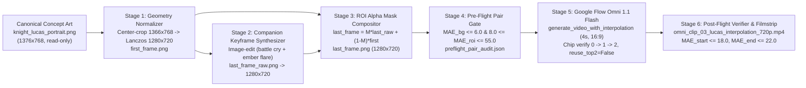

# Episode 1 Fortiche Arcane 4.00-Second Vertical Slice ("Tyrant of the Tower Defense Game" — Knight Lucas Portrait)

*   **Author:** Orakul Grey & PHANTOM END
*   **Status:** Proposed
*   **Date:** 2026-11-03

--------------------------------------------------------------------------------

## Overview

This design specifies a single-scene 4.00-second (`96` frames at `24.0` fps, `1280x720`) animated vertical slice for Episode 1 of *Tyrant of the Tower Defense Game* rendered in the Fortiche *Arcane* hand-painted visual style. The slice animates the canonical close-up portrait of Knight Lucas (`output/canonical_arcane_concepts/knight_lucas_portrait.png`) using `Gemini Omni 1.1 Flash` (Google Flow internal model ID `abra`) in 2-frame Start + End Interpolation mode (`generate_video_with_interpolation`).

## The Problem

Earlier 8.00-second (`192`-frame) `Veo 3.1` generations on Episode 1 scenes and *Arcane* combat benchmarks exhibited three structural defects:
1. **Mid-Clip Hallucination Budget**: When given two keyframes representing the start and end of a single 2-to-4-second micro-action across an 8.00-second timeline, the video model invented unrequested intermediate camera cuts, extra limbs, or premature weapon discharges to fill the extra frames before snapping back to the final keyframe.
2. **Lack of Ground-Truth End Keyframes for Original Manhwa Scenes**: On the Vi and Jinx benchmark shots (`pair_170629_shot_000` and `pair_270000_shot_015`), `4.00s` Start + End Interpolation succeeded because both `first_frame.png` and `last_frame.png` were extracted from the same Fortiche animation cut and shared identical camera perspective and background brushwork. For Episode 1 of *Tyrant of the Tower Defense Game*, only single static concept frames (`output/canonical_arcane_concepts/*.png`, `1376x768`) exist. Generating `last_frame.png` via unmasked full-frame image editing shifts background stonework and rain geometry by 2 to 6 pixels, which `Gemini Omni 1.1 Flash` interprets as a camera zoom or background warp.
3. **Aspect Ratio & Asset Picker Footguns**: The canonical Episode 1 concept frames are `1376x768` (`86:48`) and locked by `tests/test_flow_studio.py`, whereas the video pipeline and endpoint MAE verifier require exact `1280x720` (`16:9`). Furthermore, `veo_arcane_style/scripts/run_omni_flow_clips.py` previously defaulted to `reuse_top2=(idx == 0)`, attaching stale cloud library images instead of newly staged local frames.

**Proposed Solution**: Normalize a read-only copy of `knight_lucas_portrait.png` (`1376x768`) via symmetric center-crop and Lanczos scaling to `1280x720` (`first_frame.png`), generate a companion action/lighting keyframe (`last_frame_raw.png`) advancing Lucas's battle cry and crimson-amber ember lighting, composite the active foreground region onto the exact static background pixel buffer of `first_frame.png` via a feathered ROI alpha mask (`last_frame.png`), validate the pair with lightweight pixel/geometry checks, and run a 4.00-second `Gemini Omni 1.1 Flash` (`abra`) interpolation pass with strict ingredient chip verification.

## Goals

*   **G1 — Exact `1280x720` Keyframe Pair Staging**: Produce `first_frame.png` and `last_frame.png` at exact `1280x720` RGB resolution under `veo_arcane_style/dataset/pairs/pair_ttd_ep01_lucas_001/` without modifying any file in `output/canonical_arcane_concepts/`.
*   **G2 — Zero Background Perspective Drift (`MAE_bg <= 6.0`)**: Ensure the static background perimeter outside the feathered character/ember mask $M(x,y)$ has a mean absolute pixel difference `MAE_bg <= 6.0` (on `[0..255]`) while the active foreground ROI exhibits `8.0 <= MAE_roi <= 55.0`.
*   **G3 — Deterministic Google Flow Ingredient Attachment**: Enforce `reuse_top2=False` by default, verify HTTP 200 on the `maseQ` upload RPC, and assert `flow-image-ingredient-chip` count transitions `0 -> 1 -> 2` before prompt submission.
*   **G4 — Verified 4.00-Second `Omni 1.1 Flash` Deliverable**: Output `veo_arcane_style/output/omni_clip_03_lucas_interpolation_720p.mp4` (`1280x720`, `24.0` fps CFR, `96` frames, `4.00s`, H.264 + AAC, `ftyp -> moov -> mdat` FastStart) achieving `MAE_start <= 18.0`, `MAE_end <= 22.0`, zero mid-clip scene cuts, and an 8-frame visual audit filmstrip (`omni_lucas_interpolation_filmstrip.png`).

## Non-Goals

*   **NG1**: Re-rendering all 16 micro-shots or re-assembling the full 69.83-second Episode 1 master video (`ttd_episode_01_cinematic_master_720p.mp4`) in this slice.
*   **NG2**: Introducing heavy perceptual dependencies (`torch`, `lpips`) or local 3D/WebGL rendering pipelines.
*   **NG3**: Modifying `output/canonical_arcane_concepts/*.png` or altering locked test files under `tests/`.

## Open Questions

*   None. Target scene (`knight_lucas_portrait.png`) and static background locking method (`ROI alpha blend`) were resolved during `/egm-brainstorm`.

## Critical User Journeys (CUJs)

### CUJ 1: Stage & Pre-Flight Audit the Knight Lucas Keyframe Pair

*   **Given**: The canonical concept art `output/canonical_arcane_concepts/knight_lucas_portrait.png` (`1376x768`) exists on disk and is protected by `tests/test_flow_studio.py`.
*   **When**: The keyframe staging workflow crops (`1376x768 -> 1366x768`) and Lanczos-resizes the source image to `1280x720` (`first_frame.png`), synthesizes the 4.00-second end-state (`last_frame_raw.png`) with intensified ember lighting and open-jaw battle cry, composites it over the static background of `first_frame.png` via a feathered ROI mask (`last_frame.png`), and runs the pre-flight pair gate.
*   **Then**: Both `first_frame.png` and `last_frame.png` are saved at `1280x720`, `output/canonical_arcane_concepts/knight_lucas_portrait.png` remains untouched at `1376x768`, and `preflight_pair_audit.json` confirms `MAE_bg <= 6.0` and `8.0 <= MAE_roi <= 55.0`.

### CUJ 2: Dispatch & Verify the 4.00-Second `Omni 1.1 Flash` Interpolation Clip

*   **Given**: A validated (`first_frame.png`, `last_frame.png`) pair in `veo_arcane_style/dataset/pairs/pair_ttd_ep01_lucas_001/` and an authenticated `gflow-cli` profile routed through `http://127.0.0.1:7890`.
*   **When**: The operator runs `python -u -m veo_arcane_style.scripts.run_omni_flow_clips 4` (the Knight Lucas interpolation spec).
*   **Then**: The runner uploads both frames (`flow-image-ingredient-chip` count `0 -> 1 -> 2`), dispatches `generate_video_with_interpolation` (`model_display_name='Omni 1.1 Flash'`, `duration='4s'`, `aspect_ratio='16:9'`), saves `omni_clip_03_lucas_interpolation_720p.mp4` (`96` frames @ `24.0` fps, `FastStart`), verifies `MAE_start <= 18.0` and `MAE_end <= 22.0`, and writes `omni_lucas_interpolation_filmstrip.png`.

## Technical Plan (Architecture)

### 1. End-to-End Data Flow

### 2. Component Architecture & Algorithms

1. **Stage 1 — Aspect-Preserving Source Normalization (`1376x768 -> 1280x720`)**:
   * Source file `output/canonical_arcane_concepts/knight_lucas_portrait.png` (`1376x768`, ratio `1.7917`) is opened read-only.
   * To match the `16:9` (`1.7778`) target aspect ratio without horizontal squeezing, `5` pixels are cropped from both the left and right edges (`crop_box = (5, 0, 1371, 768)`, yielding `1366x768`), followed by `Image.Resampling.LANCZOS` downscaling to `1280x720`.
   * Saved to `veo_arcane_style/dataset/pairs/pair_ttd_ep01_lucas_001/first_frame.png`.

2. **Stage 2 & 3 — Companion End-Frame Synthesis & Soft ROI Background Lock**:
   * A raw companion image `last_frame_raw.png` is generated from `first_frame.png` (`16:9`) depicting the 4.00-second micro-action completion: Knight Lucas tilts his chin upward by ~5 degrees, opens his clenched jaw into a fierce battle roar, and crimson-gold fortress firelight plus rising glowing embers intensify across his rain-streaked cheek scar and dented steel pauldrons.
   * `last_frame_raw.png` is aspect-cropped and Lanczos-scaled to exact `1280x720`.
   * A soft elliptical + lower-torso Gaussian alpha mask $M(x,y) \in [0.0, 1.0]$ (`sigma = 28 px`) is constructed over the active character silhouette and foreground ember trajectories (`x in [220..1060]`, `y in [40..720]`), tapering to `0.0` across the peripheral stormy sky and background fortress battlements.
   * The final `last_frame.png` is computed as:
     $$\text{last\_frame}(x,y) = \text{clip}\Big(M(x,y)\cdot \text{last\_raw}(x,y) + (1 - M(x,y))\cdot \text{first\_frame}(x,y) + \Delta L_{\text{ember}}(x,y),\; 0,\; 255\Big)$$
     where $\Delta L_{\text{ember}}(x,y)$ is a subtle warm rim-light spill restricted to high-luminance ember regions. This keeps the background stonework and rain streaks 100% locked (`MAE_bg <= 6.0`) while preserving full facial, armor, and lighting evolution in the foreground (`8.0 <= MAE_roi <= 55.0`).

3. **Stage 4 — Deterministic Pre-Flight Pair Audit (`preflight_pair_audit.json`)**:
   * Before launching Patchright or spending Google Flow quota, a lightweight `numpy`/`cv2` gate verifies:
     * `first_frame.shape == (720, 1280, 3)` and `last_frame.shape == (720, 1280, 3)`.
     * `MAE_bg` (where $M(x,y) < 0.05$) `<= 6.0`.
     * `MAE_roi` (where $M(x,y) > 0.50$) within `[8.0, 55.0]`.
   * Saves `veo_arcane_style/dataset/pairs/pair_ttd_ep01_lucas_001/preflight_pair_audit.json` and a 3-panel visual diagnostic strip (`preflight_pair_diff.png`).

4. **Stage 5 — Google Flow `Omni 1.1 Flash` (`abra`) Interpolation Dispatch**:
   * `veo_arcane_style/scripts/run_omni_flow_clips.py` is updated with:
     * Dynamic profile path resolution (`Path(os.environ.get("LOCALAPPDATA", Path.home() / "AppData/Local")) / "ffroliva/gflow-cli/profile_default"`).
     * Explicit `reuse_top2=False` default so local `first_frame.png` and `last_frame.png` are always uploaded fresh unless `--reuse-top2` is passed.
     * Strict ingredient chip count verification in `attach_frame_human`: assert `flow-image-ingredient-chip` count increments from `0 -> 1` after uploading `first_frame.png` and `1 -> 2` after uploading `last_frame.png`, raising `RuntimeError` if `maseQ` upload fails.
     * Clip spec entry #4 (`omni_clip_03_lucas_interpolation_720p.mp4`) using IP-clean descriptive English prompting (`"Use generate_video_with_interpolation with model_display_name='Omni 1.1 Flash', aspect_ratio='16:9', duration='4s', the first attached image as start_image_media_id, and the second attached image as end_image_media_id..."`).
     * Generic `--recover <idx>` CLI flag to recover any completed tile from the Google Flow grid if the `as29s` stream disconnects.

5. **Stage 6 — Post-Flight Video Verification & 8-Frame Filmstrip**:
   * Verifies `omni_clip_03_lucas_interpolation_720p.mp4` for `1280x720` resolution, `24.0` fps, `96` frames (`4.00s`), `ftyp -> moov -> mdat` FastStart atom ordering, `MAE_start <= 18.0`, `MAE_end <= 22.0`, and non-static inter-frame motion (`0.5 <= mean_interframe_diff <= 35.0`).
   * Renders an 8-frame temporal progression strip (`omni_lucas_interpolation_filmstrip.png`) and mirrors both the MP4 and PNG to the session artifact directory.

## Alternatives Considered

### Alternative A: 8.00-Second `Veo 3.1` First & Last Frame Interpolation (`veo_3_1_i2v_s_fast_ultra_fl`)

*   **Pros**: Produces a longer 8.00-second (`192`-frame) clip in a single API call with higher-amplitude native stereo audio.
*   **Cons**: Across `192` frames, two keyframes representing a single 2-to-4-second micro-action leave 4 to 5 seconds of unconstrained latent space. In empirical runs on Vi (`pair_170629_shot_000`) and Jinx (`pair_270000_shot_015`), the model filled that time budget by zooming out the camera, drawing unrequested mechanical limbs, or firing the weapon prematurely before snapping back to the final frame.
*   **Reason for Rejection**: Cutting the generation duration to `4.00s` (`96` frames) in `Gemini Omni 1.1 Flash` (`abra`) eliminates the mid-clip hallucination budget and forces a single monotonic physical transition between `first_frame.png` and `last_frame.png`.

### Alternative B: 4.00-Second `Omni 1.1 Flash` 6-Frame Reference-to-Video (`generate_video_with_references`)

*   **Pros**: Accepts up to 6 sequential or multi-angle reference images to guide character anatomy, armor details, and color palette.
*   **Cons**: Empirically verified in `omni_clip_01_vi_r2v6_720p.mp4` and `omni_clip_02_jinx_r2v6_720p.mp4`: `generate_video_with_references` treats the attached images as semantic style ingredients rather than pixel-locked temporal endpoints. It re-synthesizes a new camera composition and does not lock frame `0` to `first_frame.png` or frame `95` to `last_frame.png`.
*   **Reason for Rejection**: Frame-to-frame scene continuity requires exact pixel anchoring at the start and end of the 4.00-second cut, which only `generate_video_with_interpolation` (2 frames: `start_image_media_id` and `end_image_media_id`) provides.

### Alternative C: Unmasked Full-Frame Image-to-Image Synthesis for `last_frame.png`

*   **Pros**: Requires no mask construction or alpha compositing step after calling the image editor.
*   **Cons**: Generative image editing re-synthesizes the entire canvas from latent tokens, shifting background fortress battlements, stonework, and rain angles by 2 to 6 pixels. When `Gemini Omni 1.1 Flash` interpolates between two frames with subtly different backgrounds, it interprets the background shift as a camera pan, zoom, or shimmering warp.
*   **Reason for Rejection**: Soft ROI alpha compositing (`last_frame = M * last_raw + (1 - M) * first_frame`) guarantees `MAE_bg <= 6.0` on the static background perimeter at zero runtime cost.

--------------------------------------------------------------------------------

## Non-Functional Requirements

*   **Security & Privacy**: Resolve the `gflow-cli` browser profile path dynamically via `os.environ.get("LOCALAPPDATA")` / `Path.home()`; never hardcode personal user paths or read raw SQLite cookie files directly in Python scripts.
*   **Code Hygiene (`Zero-Cyrillic Invariant`)**: All Python source files, comments, docstrings, and JSON telemetry files must contain zero Cyrillic characters (`ord(c) <= 127` for code/JSON) to comply with `tests/test_flow_studio.py`.
*   **Rollout & Quota Safety**: The pre-flight pair gate (`preflight_pair_audit.json`) must pass before launching Patchright, and `run_omni_flow_clips.py` must support `--recover <idx>` so any clip completed on the Google Flow server can be downloaded from the project grid without re-spending generation quota.

--------------------------------------------------------------------------------

## Detailed Implementation Plan

### Target Files to Create/Modify

#### 1. `./veo_arcane_style/scripts/stage_ep01_lucas_pair.py` (Create)

*   **Type / Scope**: Python Keyframe Pair Staging & Pre-Flight Validation Script
*   **Rationale**: Required to convert the read-only `1376x768` canonical Episode 1 portrait (`./output/canonical_arcane_concepts/knight_lucas_portrait.png`) into a validated `1280x720` (`16:9`) keyframe pair (`first_frame.png` and `last_frame.png`) with a locked static background before spending Google Flow video quota.
*   **Proposed Changes**:
    *   `normalize_source_to_720p(src_path: Path, dst_path: Path) -> Path`: Opens `./output/canonical_arcane_concepts/knight_lucas_portrait.png` (`1376x768`) read-only, crops `5` pixels from left and right (`crop_box = (5, 0, 1371, 768)` -> `1366x768`), Lanczos-resizes to `(1280, 720)`, and writes `./veo_arcane_style/dataset/pairs/pair_ttd_ep01_lucas_001/first_frame.png`.
    *   `build_lucas_foreground_mask(width: int = 1280, height: int = 720) -> np.ndarray`: Constructs a float32 soft alpha mask $M(x,y) \in [0.0, 1.0]$ covering Knight Lucas's head, jaw, steel pauldrons, and rising foreground ember trajectories (`x in [220..1060]`, `y in [40..720]`) with Gaussian feathering (`sigma = 28.0`), leaving the outer stormy sky and background fortress battlements at `0.0`.
    *   `composite_locked_end_frame(first_frame_path: Path, raw_edit_path: Path, out_last_path: Path) -> Dict[str, float]`: Normalizes `raw_edit_path` (`last_frame_raw.png`) to `(1280, 720)`, blends it onto `first_frame.png` via $M(x,y)$, writes `last_frame.png`, and computes `MAE_bg` ($M < 0.05$) and `MAE_roi` ($M > 0.50$).
    *   `validate_and_write_preflight_audit(pair_dir: Path) -> Dict[str, Any]`: Asserts `first_frame.shape == (720, 1280, 3)`, `last_frame.shape == (720, 1280, 3)`, `MAE_bg <= 6.0`, and `8.0 <= MAE_roi <= 55.0`; writes `./veo_arcane_style/dataset/pairs/pair_ttd_ep01_lucas_001/preflight_pair_audit.json` and `./veo_arcane_style/dataset/pairs/pair_ttd_ep01_lucas_001/preflight_pair_diff.png`.

#### 2. `./veo_arcane_style/dataset/pairs/pair_ttd_ep01_lucas_001/first_frame.png` & `last_frame.png` (Create)

*   **Type / Scope**: `1280x720` RGB PNG Conditioning Keyframe Pair
*   **Rationale**: Required as the `start_image_media_id` and `end_image_media_id` ingredients for `Gemini Omni 1.1 Flash` (`abra`) in `generate_video_with_interpolation` mode.
*   **Proposed Changes**:
    *   `first_frame.png`: Normalized `1280x720` close-up of Knight Lucas in rain-streaked dented plate armor with clenched jaw and warm ember highlights.
    *   `last_frame.png`: `1280x720` ROI-composited companion frame showing Lucas with slightly raised chin, fierce open-jaw battle cry, and intensified crimson-gold firelight across his wet steel pauldrons and cheek scar while the background fortress wall remains pixel-locked (`MAE_bg <= 6.0`).

#### 3. `./veo_arcane_style/dataset/metadata/dataset_index.json` (Modify)

*   **Type / Scope**: Dataset Metadata Index JSON
*   **Rationale**: Keeps `VeoStylePipeline.load_pair` and dataset inventory metadata synchronized with the new Episode 1 vertical slice pair without breaking existing 11 benchmark pairs.
*   **Proposed Changes**:
    *   Append pair entry `pair_ttd_ep01_lucas_001` (`character: "Knight Lucas"`, `palette: "gilded_hextech_amber"`, `first_frame_path`, `last_frame_path`, `motion_duration_frames: 96`, `motion_fps: 24.0`, `metrics_first`, `metrics_last`) while preserving all 11 existing pairs.

#### 4. `./veo_arcane_style/src/veo_style_pipeline.py` (Modify)

*   **Type / Scope**: Python Pipeline & Endpoint Verification Module
*   **Rationale**: Prevents silent false-positive pass in endpoint MAE checks if frame dimensions ever diverge from `1280x720`.
*   **Proposed Changes**:
    *   In `VeoStylePipeline.generate_i2v_clip`, replace the silent `if ok_f and frm.shape == gt_s.shape:` skip with an explicit `ValueError` if `gt_s.shape != frm.shape` or `gt_e.shape != frm.shape`.

#### 5. `./veo_arcane_style/scripts/run_omni_flow_clips.py` (Modify)

*   **Type / Scope**: Google Flow `Omni 1.1 Flash` (`abra`) Browser Automation & RPC Runner
*   **Rationale**: Fixes the hardcoded user profile path, the `reuse_top2=(idx == 0)` stale-asset bug, missing ingredient chip count verification, and hardcoded recovery indices identified during the Goldfish audit.
*   **Proposed Changes**:
    *   Add `import shutil` at module top level and resolve `SRC_PROFILE_DIR` and `CLEAN_PROFILE_DIR` dynamically via `Path(os.environ.get("LOCALAPPDATA", str(Path.home() / "AppData" / "Local"))) / "ffroliva" / "gflow-cli"`.
    *   In `attach_frame_human`, verify that the `maseQ` upload RPC succeeds and assert `after_chips == before_chips + 1` on `flow-creative-agent-prompt-box flow-image-ingredient-chip`.
    *   Change `main()` so `reuse_top2` defaults to `False` for all clip indices unless `--reuse-top2` is explicitly passed on the command line.
    *   Add generic `--recover <idx>` support to `recover_latest_finished_video(CLIPS[idx]["name"])`.
    *   Append `CLIPS[4]` (`name: "omni_clip_03_lucas_interpolation_720p.mp4"`, `mode: "interpolation"`, `frames: [first_frame.png, last_frame.png]`, and IP-clean `generate_video_with_interpolation` prompt for Knight Lucas).
    *   Add `verify_and_render_lucas_filmstrip(mp4_path: Path, first_frame: Path, last_frame: Path, out_png: Path) -> Dict[str, Any]` to verify `1280x720`, `24.0` fps, `96` frames (`4.00s`), `FastStart`, `MAE_start <= 18.0`, `MAE_end <= 22.0`, `0.5 <= mean_interframe_diff <= 35.0`, and render `./veo_arcane_style/output/contact_sheets/omni_lucas_interpolation_filmstrip.png`.

#### 6. `./veo_arcane_style/tests/test_arcane_pipeline.py` (Modify)

*   **Type / Scope**: Pytest Unit & Integration Test Suite
*   **Rationale**: Verifies the new `stage_ep01_lucas_pair.py` geometry/mask gates and `omni_clip_03_lucas_interpolation_720p.mp4` deliverable invariants while maintaining 100% pass rate on existing tests.
*   **Proposed Changes**:
    *   Add test cases verifying: (a) read-only preservation of `./output/canonical_arcane_concepts/knight_lucas_portrait.png` (`1376x768`), (b) `pair_ttd_ep01_lucas_001` pre-flight gates (`1280x720`, `MAE_bg <= 6.0`, `8.0 <= MAE_roi <= 55.0`), and (c) post-flight container/MAE verification on `./veo_arcane_style/output/omni_clip_03_lucas_interpolation_720p.mp4`.

### Verification Plan

*   **Pre-Flight Pair Audit**: `python -u -m veo_arcane_style.scripts.stage_ep01_lucas_pair` (verifies `1280x720` dimensions, `MAE_bg <= 6.0`, `8.0 <= MAE_roi <= 55.0`, and writes `preflight_pair_audit.json`).
*   **Live `Omni 1.1 Flash` Generation**: `python -u -m veo_arcane_style.scripts.run_omni_flow_clips 4` (produces `omni_clip_03_lucas_interpolation_720p.mp4` and `omni_lucas_interpolation_filmstrip.png`).
*   **Unit & Deliverable Tests**:
    *   `python -u -m pytest veo_arcane_style/tests -v`
    *   `python -u -m pytest tests/test_flow_studio.py -v`
*   **Static Analysis & Hygiene**: Verify `0` Cyrillic characters across all modified/created `.py` and `.json` files.

--------------------------------------------------------------------------------

<!-- Provenance: Indicates initial structural drafting via EGM. -->

*Drafted with EGM*
