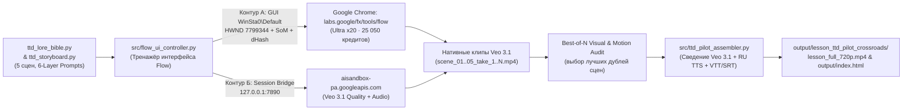

# План реализации: Автоматизация интерфейса Google Flow (Veo 3.1 Ultra x20) и генерация пилотного выпуска «Тиран в оборонительной игре»

> [!IMPORTANT]
> **Смена парадигмы рендера (отказ от локальной процедурной отрисовки):**
> Ранее собранный пилот (`lesson_ttd_pilot_crossroads`) использовал локальный процедурный Pillow-рендерер как оффлайн-заглушку. В рамках этого плана мы полностью переводим производство на **живой Google Flow (`https://labs.google/fx/tools/flow`, движок Veo 3.1)** через открытое окно Google Chrome (`HWND 7799344`, аккаунт `Razor Grey / reyzorrray@gmail.com`, баланс **25 050 бонусов Google Flow**, водяной знак отключён).

---

## 1. Диагностика среды и доступных каналов управления Flow

В результате инспекции рабочей станции (`WinSta0\Default`) подтверждены:
1. **Живое окно браузера с открытым Google Flow**:
   - Процесс: `chrome.exe` (`PID 17628`, `HWND 7799344`, класс `Chrome_WidgetWin_1`, геометрия `1936×1168`).
   - Заголовок: `Google Flow — творческая ИИ-студия для создания видео, изображений и специальных инструментов - Google Chrome`.
   - Состояние на экране ([media_1793533679259_ac379d35.png](file:///C:/Users/Orakul%20Grey/.gemini/antigravity/brain/94dd6a04-54e7-4e8c-9551-224cace4f85f/.user_uploaded/media_1793533679259_ac379d35.png)): открыта стартовая страница Flow с кнопками `+ Новый проект` (`+ New Project`), `Start Creating` и открытым попапом профиля (`25 050 бонусов Google Flow`, `Видимый водяной знак: off`).
2. **Локальный прокси-маршрут**:
   - Активен туннель `127.0.0.1:7890` (HTTP/SOCKS), обеспечивающий прямой доступ к `labs.google/fx/*` и `aisandbox-pa.googleapis.com/v1/*`.
3. **Двухконтурная архитектура управления (`Dual-Track Flow Automation`)**:
   - **Контур А — Тренажёр и визуальный контроллер интерфейса (`WindowSessionManager` + `Set-of-Marks` + `VisualActionOracle`)**: прямое управление живым окном Chrome (`HWND 7799344`) на десктопе `WinSta0\Default` с нормализацией координат `[0..1000]`, снятием GDI-скриншотов, разметкой UIA/DOM-элементов и проверкой каждого клика/ввода через 64-битный перцептивный хэш (`dHash Hamming >= 2`).
   - **Контур Б — Прямой API/DOM-мост сессии Flow (`labs.google/fx/api/auth/session` → `aisandbox-pa.googleapis.com`)**: перехват активного токена сессии из живого браузера для пакетного запуска генераций `veo_3_1_t2v_quality_audio` и прямого скачивания нативных MP4-потоков без потерь качества.

---

## 2. Архитектура решения и изменяемые компоненты

### Этап 1: Разработка контроллера и тренажёра интерфейса Google Flow ([src/flow_ui_controller.py](file:///e:/ANTIGRAVITY/flow_video_testbench/src/flow_ui_controller.py))
Создаём специализированный модуль `src/flow_ui_controller.py` (с соблюдением требований `REQ-FLOW-UI-01..04`):
1. **Привязка к окну и карта элементов интерфейса Flow (`FlowUIMap`)**:
   - Автоматический поиск окна `Google Flow` (`HWND 7799344` или по подстроке заголовка `Google Flow`) через `enumerate_visible_windows()` на десктопе `WinSta0\Default`.
   - Калибровка и нормализация координат `[0..1000] × [0..1000]` для ключевых узлов интерфейса:
     - Закрытие попапа аккаунта (`[X]` в правом верхнем углу попапа `[972, 41]` или клик в свободную зону).
     - Вход в редактор: кнопка `+ Новый проект` (`[500, 885]`) / `Start Creating` (`[69, 442]`).
     - Панель настроек генерации: выбор режима `Text to Video` (`Текст в видео`), выбор модели **Veo 3.1 - Quality** (максимальное качество с нативным звуком), формат **16:9**, количество выходов на промпт (**x2 / x4 дубля** — чтобы эффективно жечь пул из `25 050` кредитов и отбирать лучший кадр).
     - Поле ввода промпта (`Prompt Textarea`), кнопка отправки (`Generate` / `Создать`), таймлайн `Scenebuilder` (`Add to scene`, `Extend`) и кнопка экспорта (`Download MP4`).
2. **Визуальный оракул и журнал тренировки (`VisualActionOracle` + Telemetry Log)**:
   - Перед каждым действием и после него снимается кадр окна через `capture_screen_frame`, вычисляется `64-bit dHash`, сохраняется серия размеченных скриншотов (`flow_ui_step_01..N.png`) и JSON-карта переходов состояний (`output/lesson_ttd_pilot_crossroads/flow_ui_training_log.json`).
3. **Синхронизация сессии и прямой загрузчик (`FlowLiveSessionBridge`)**:
   - Автоматическое извлечение свежего OAuth/Session-токена из активного окна Chrome (через DevTools/Clipboard/Session API в контексте вкладки Flow) и обновление локального хранилища сессии, чтобы `FlowBridge` мог параллельно запрашивать статус рендера и скачивать готовые `.mp4` напрямую.

---

### Этап 2: Генерация пилотного выпуска «Перекрёсток — Первая волна» через живой Google Flow (Veo 3.1)
Прогоняем все **5 сцен** пилотного эпизода (`build_ttd_pilot_storyboard()` в [src/ttd_storyboard.py](file:///e:/ANTIGRAVITY/flow_video_testbench/src/ttd_storyboard.py)) через реальный Google Flow в режиме **Veo 3.1 - Quality (`16:9`, без водяного знака)** с мульти-дублями (по 2–4 вариации на каждую сцену для отбора лучших кинематографических планов):

| № сцены | Таймкод | Сюжетный узел | 6-Layer Veo 3.1 Prompt (Subject + Environment + Motion + Camera + Lighting + Audio) |
| :--- | :--- | :--- | :--- |
| **Сцена 1** | `00:00–00:08` | **Южный Бастион «Перекрёсток» и Чёрный Туман** | Медленный кинематографический пролёт камеры (`slow descending crane shot, 24mm anamorphic`) над разрушенными зубчатыми стенами крепости под проливным дождём и кровавой луной; из чёрного тумана вспыхивают сотни багровых глаз монстров (`bioluminescent crimson eyes`). |
| **Сцена 2** | `00:08–00:16` | **Принц Эш Борнхейтер на командном шпиле** | Крупный план (`low-angle push-in, 35mm`) Эша в тёмно-синем форменном плаще с золотым аксельбантом; он поднимает стальной командирский жезл, лазурный тактический кристалл пульсирует голубым светом на его лице. |
| **Сцена 3** | `00:16–00:24` | **Железный бастион Рыцаря Лукаса** | Динамичный боковой трекинг (`40mm action tracking shot, camera shake on impact`): Лукас в вороненых латах со шрамом на щеке вбивает ростовой щит-павезу в мокрый камень; пикирующая каменная гаргулья врезается в щит в снопе золотых искр. |
| **Сцена 4** | `00:24–00:32` | **Бронебойный выстрел снайпера Лили** | Быстрый переход (`whip-pan to macro slow-motion follow, 85mm`): Лили в промокшем серо-зелёном плаще спускает тетиву рогового лука; стальная стрела-бодкин рассекает капли дождя в полёте и пробивает светящийся глаз гаргульи. |
| **Сцена 5** | `00:32–00:42` | **Кульминация: Тактическое Троединство против Живого Доспеха** | Широкий эпический план (`28mm heroic crane-up`): гигантский Проклятый Живой Доспех обрушивает двуручный меч на щит Лукаса, Эш отдаёт приказ жезлом, а стрела Лили взрывает фиолетово-багровое ядро души в груди босса. |

> [!TIP]
> **Эффективное использование подписки Ultra x20 (`25 050` кредитов):**
> Для каждой из 5 сцен мы генерируем серию дублей в максимальном профиле **Veo 3.1 - Quality** (и при необходимости используем `Extend` / `Add to scene` в `Scenebuilder`), сохраняя все сгенерированные исходники в `output/lesson_ttd_pilot_crossroads/flow_raw_takes/` и выбирая лучший дубль по чёткости движения, отсутствию артефактов и соответствию канону персонажей (`best-of-N selection`).

---

### Этап 3: Сведение финального мастера, озвучка и верификация по `/iso9000-agentops`
1. **Обновление сборщика пилота ([src/ttd_pilot_assembler.py](file:///e:/ANTIGRAVITY/flow_video_testbench/src/ttd_pilot_assembler.py))**:
   - Замена процедурного генератора кадров на импорт реальных видеоклипов Veo 3.1 из Google Flow (`scene_01_flow_veo31.mp4` .. `scene_05_flow_veo31.mp4`).
   - **Двухдорожечный аудио-микс (`Studio Audio Ducking`)**: сохраняем нативную звуковую дорожку Veo 3.1 (шум ливня, лязг стали, грохот ударов, гул тумана) на уровне `-12 dB` под студийной русской озвучкой рассказчицы (`voice_y0joebp3bwta`, `24 kHz WAV`) и репликами героев.
   - **Чистый видеопоток + внешние/мягкие субтитры**:
     - Сохраняем чистую кинематографическую версию Veo 3.1 и мастер-версию `output/lesson_ttd_pilot_crossroads/lesson_full_720p.mp4` + синхронные субтитры `.vtt`/`.srt` и обновлённую карточку в `output/index.html`.
2. **Конвейер качества ISO 9001:2015 / Agile V (`P30`)**:
   - Заморозка базовой линии требований (`REQ-FLOW-UI-01..04`: привязка к окну Flow, навигация и запуск генерации в UI, скачивание реальных Veo 3.1 MP4, сборка мастера с проверкой `ffprobe`/покадрового контакт-листа).
   - Разделение ролей `TEST_DESIGN` (тесты в [tests/test_flow_studio.py](file:///e:/ANTIGRAVITY/flow_video_testbench/tests/test_flow_studio.py)) и `SYNTHESIS` (реализация в `src/flow_ui_controller.py` и `src/ttd_pilot_assembler.py`).
   - Покадровый визуальный аудит сгенерированных Veo 3.1 роликов (контакт-лист `ttd_flow_veo31_contact_sheet.png`), прогон `pytest`, выпуск SARIF 2.1.0 сертификата и отчёт в корневую сессию.
